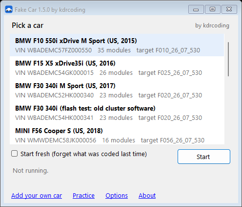
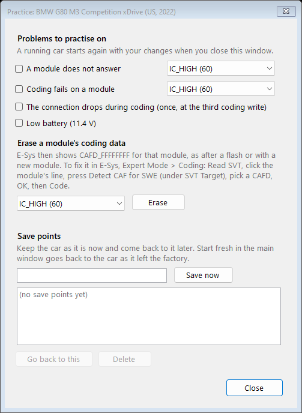
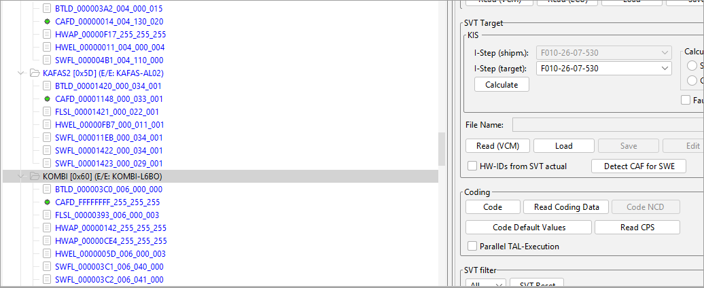
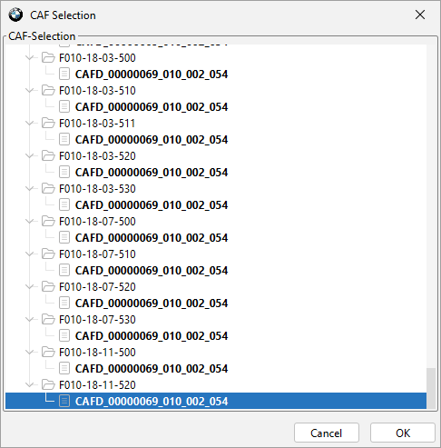
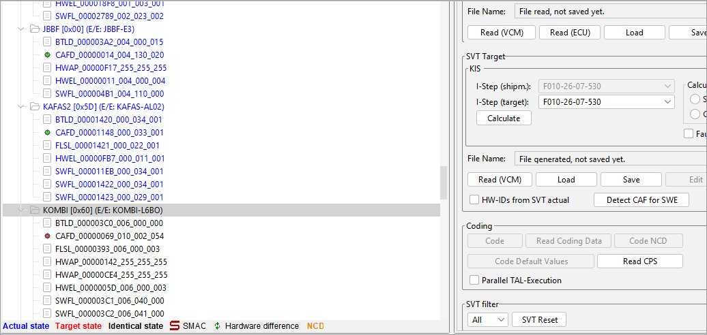
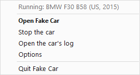
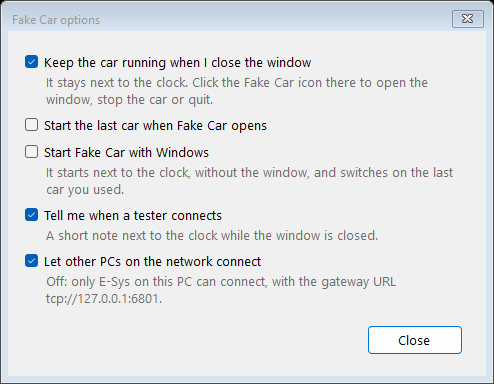
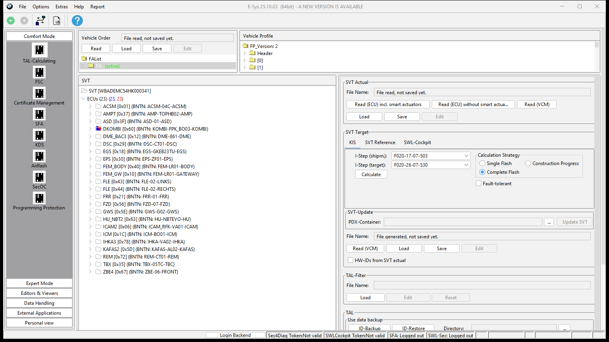
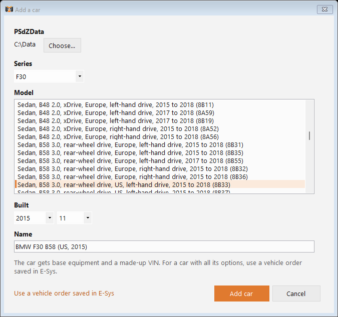
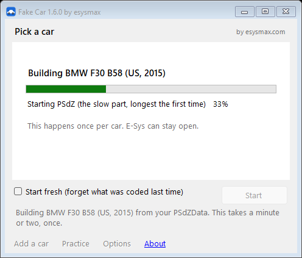

# Fake Car

**A pretend BMW for E-Sys.** Start it on your PC, and E-Sys finds it and works with it like a real car: read and write the vehicle order, code modules, flash software, enter FSC codes, read faults. Then break it on purpose and practise fixing it.

Use it to learn E-Sys, try a coding tool before it touches a real car, or record a video without a car and without showing a real VIN.

**[Download the latest version](https://github.com/kdrcoding/fake-car/releases/latest)** · Free · Windows 10 and 11 · 11 car models · by [esysmax](https://esysmax.com)



## Quick start

1. Download `FakeCar-<version>.zip` from [Releases](https://github.com/kdrcoding/fake-car/releases/latest) and unzip it anywhere.
2. Start `FakeCar.exe`, pick a car, press **Start**. The first start of a car builds it from your PSdZData (a minute or two, once).
3. In E-Sys, click **Open Connection** and either
   - pick the Fake Car by its VIN under **Connection via VIN**, or
   - choose **Connection via gateway URL**, enter `tcp://127.0.0.1:6801`, pick the target the Fake Car window shows for the running car (for example `F020_26_07_530` for the F30), and tick **Read parameters from VCM**. A target of another series connects too, but E-Sys's TAL calculation then stops with a PSdZ error ("DetailInfo must not be null").
4. Work as you would with a real car. The window shows when E-Sys is connected.

Everything you change stays for next time. Tick **Start fresh** to go back to the car as it left the factory.

## Practise fixing a car

Click **Practice** in the window to make the picked car misbehave on purpose, the way real cars do.



| Problem | What E-Sys sees |
|---|---|
| Erase a module's coding data | The module shows `CAFD_FFFFFFFF`, as after a flash or with a new module. |
| A module does not answer | That module is silent, as if unplugged. |
| Coding fails on a module | Coding writes to that module are refused. |
| The connection drops during coding | The connection breaks once, at the third coding write. |
| Low battery | The engine computer reports 11.4 V. |

**Save points** keep the car as it is (everything coded, flashed or written) so you can go back to it later, for example before a risky change or for a second take of a video. **Start fresh** still goes back to the car as it left the factory.

A running car starts again by itself with your changes when you close the Practice window. Problems are kept in `problems.txt`, save points in `savepoints`, both in the car's folder.

### Fix CAFD_FFFFFFFF in E-Sys

Erase the instrument cluster's coding data in **Practice**, connect, and open **Expert Mode > Coding**. These pictures are from E-Sys 25.10 with the F10.

**1.** **Read** the vehicle order, then **Read (ECU)** under SVT Actual. The cluster shows `CAFD_FFFFFFFF_255_255_255`: it has no coding data.



**2.** Click the **module's line**, `KOMBI [0x60]`, not the CAFD line. Press **Detect CAF for SWE** under SVT Target. E-Sys lists the CAFD that fits the cluster's software at each I-step: pick one and press **OK**.



**3.** With `KOMBI [0x60]` still selected, press **Code**. E-Sys codes the cluster with that CAFD.

**4.** **Read (ECU)** again: the cluster has its CAFD back.



## Runs next to the clock

Close the window and the car keeps running. Click the Fake Car icon next to the clock to open the window, or right-click it for the menu. Starting `FakeCar.exe` again brings the open window to the front.

<table>
<tr>
<td width="50%" valign="top"></td>
<td width="50%" valign="top"></td>
</tr>
<tr>
<td valign="top">The icon's menu while a car runs</td>
<td valign="top">Options: each choice works as soon as you tick it</td>
</tr>
</table>

| Option | What it does |
|---|---|
| Keep the car running when I close the window | On by default. Off: closing the window switches the car off. |
| Start the last car when Fake Car opens | The car you used last starts by itself. |
| Start Fake Car with Windows | Fake Car starts next to the clock, without the window, with the last car on. |
| Tell me when a tester connects | A short note next to the clock while the window is closed. The window always shows it. |
| Let other PCs on the network connect | On by default. Off: only E-Sys on this PC finds and connects to the car (by its VIN or with the gateway URL `tcp://127.0.0.1:6801`); other PCs are turned away. |
| PSdZData folder | The PSdZData the cars are built from. Automatic: the one E-Sys uses. Choose another, older or newer: the cars are built again from it on their next start. |
| E-Sys folder | The E-Sys the builder runs with. Automatic: the newest found. |

Options are kept in `%APPDATA%\FakeCar\options.txt`, so a newer Fake Car keeps them.

## What you need

- Windows 10 or 11 (nothing else to install)
- E-Sys with PSdZData for the car's series: F010 (F10), F020 (F30, F80), F025 (F15), F056 (MINI F56), S15A (G30, F90), S18A (G20, G05, G80)
- Any PSdZData version, old or new: when yours does not have a car's I-steps, the car gets the closest ones it has, and the window shows that target.

## What you can do with it

| In E-Sys | Fake Car |
|---|---|
| Vehicle search, connect by VIN or gateway URL | Yes |
| Read FA, FP, I-steps, VIN | Yes |
| Write FA, FP and I-steps to the VCM | Yes, kept for next time |
| Read SVT, KIS and TAL calculation | Yes |
| Read coding, code modules | Yes, kept for next time |
| Flash software | Yes, the module reports the new version |
| FSC codes (store, read, check, cancel) | Head unit and instrument cluster, F-series cars (G-series use SFA, which needs BMW's backend) |
| Read and clear fault memory | Yes |
| Mileage kept in the modules (for used-car checks) | Every module, the body module backup and the cluster's two totals |
| Module reset | Yes |
| Service reset (CBS) and battery registration with EDIABAS service tools | Instrument cluster, engine computer and brake module answer; resets are kept for next time |

Tested with E-Sys 25.10: connecting, reading and writing FA, FP and I-steps, SVT, coding, and FSC actions (status, VIN, SID on the head unit). TAL calculation works on F- and G-series cars (F30 practice car: the cluster is planned for flashing; G80: up to date, nothing to flash). The `CAFD_FFFFFFFF` practice was fixed in E-Sys 25.10 with Detect CAF for SWE and Code. Running a full flash (Execute) is not tested yet. ISTA finds cars the same way over the network, but it is not tested yet either.

## Car models

| Model | Folder | Modules |
|---|---|---|
| BMW F10 550i xDrive M Sport (US, 2015) | `cars\F10_550i_xDrive_US` | 35 |
| BMW F30 340i M Sport (US, 2017) | `cars\F30_340i_US` | 23 |
| BMW F30 340i with old cluster software, for flash practice | `cars\F30_340i_US_flashtest` | 23 |
| BMW F80 M3 (US, 2017) | `cars\F80_M3_US` | 24 |
| BMW F90 M5 CS (US, 2021) | `cars\F90_M5_CS_US` | 29 |
| BMW G80 M3 Competition xDrive (US, 2022) | `cars\G80_M3_Competition_US` | 26 |
| BMW G20 330i (US, 2020) | `cars\G20_330i_US` | 23 |
| BMW G05 X5 xDrive40i (US, 2020) | `cars\G05_X5_40i_US` | 27 |
| BMW G30 540i (US, 2019) | `cars\G30_540i_US` | 22 |
| BMW F15 X5 xDrive35i (US, 2016) | `cars\F15_X5_35i_US` | 26 |
| MINI F56 Cooper S (US, 2018) | `cars\F56_Cooper_S_US` | 16 |

Every VIN is made up.

Each car is built on your own PC from your own PSdZData, the way the factory puts a car together: the modules its order gets, the software E-Sys's own KIS calculation wants on them at the current I-step, and the factory coding of every module for that order. So E-Sys reads what a real car with that order would answer, and a car that is up to date has nothing to flash.

## Flash a module



Use the **F30 340i with old cluster software**: its instrument cluster still has the software it was built with. Connect with the target the Fake Car window shows (F020_26_07_530 for this car).

1. **Comfort Mode > TAL-Calculating**.
2. Vehicle Order: **Read**. SVT Actual: **Read (ECU) without smart actuators**.
3. SVT Target: tick **Complete Flash**, set **I-Step (shipm.)** to the car's `ISTEP_SHIPMENT` from `car.txt` (F020-17-07-503 for the F30), then **Calculate**.
4. TAL: **TAL calculation**, **Save**, then **Execute**.

## Write FA and FP

1. **Expert Mode > VCM**, tab **Master**, **Read** under FA/FP.
2. Tab **File**: **Save** the FA to a file, then **Load** that file (change the order in between if you like).
3. In the FA tree, right-click the FA and choose **Activate FA**. E-Sys works out the FP.
4. Tab **Master**, **Write** under FA/FP.

## Add a car

Click **Add a car**. Pick the **Series** (F30, G80, X5...) and the **Model** from the list your PSdZData has, with its engine, drive, market and the years it was made. Pick when it was **Built** (only dates that car was really made are offered) and press **Add car**. Fake Car makes it with base equipment and a made-up VIN and builds it straight away. **Choose...** next to PSdZData picks other PSdZData, old or new.



Building shows how far it is, so you can see it working. Starting PSdZ is the slow part, mostly the first time.



For a car with all its options, click **Use a vehicle order saved in E-Sys** in the same window. Save your car's vehicle order in E-Sys first (**Expert Mode > VCM**, **Read**, then **Save** the FA) and pick that file. Fake Car makes a new car from it with a made-up VIN and takes the I-steps from your PSdZData.

## Your own car model by hand

Copy a car folder and change two files:

- `FA.xml`: the vehicle order. `typeKey` (type key), `series` (development series, for example F030 for an F30), `timeCriteria` (MMYY), the SA codes.
- `car.txt`: name, a made-up VIN with a valid check digit, mileage (`KM`), battery, and optionally `FAMILY` (the PSdZData family to look in, F020 for an F30). The I-steps (`ISTEP_SHIPMENT`, `ISTEP_LAST`, `ISTEP_CURRENT`) are optional: without them the builder takes them from your PSdZData and writes them in.

`faults.txt` lists the faults it has stored (module address, fault code, status, count, km).

To practise spotting a rolled-back car, add `KM_CLUSTER=30000` to `car.txt`: the instrument cluster shows 30,000 km while the other modules keep the real `KM`.

To have something to flash, add `OUTDATED=60` (module addresses, comma separated) to `car.txt`: those modules keep the software they were built with.

Start it in `FakeCar.exe`; it is built on the first start. To build by hand:

```
builder\build-car.cmd cars\F30_340i_US C:\EC-Apps\E-Sys C:\Data
```

## Without the window

```
FakeCar.exe --car cars\F30_340i_US [--bind 127.0.0.1] [--fresh] [--log fakecar.log]
FakeCar.exe --background
FakeCar.exe --stop
```

`--background` starts Fake Car next to the clock with the last car on, as **Start with Windows** does. `--stop` switches off and closes any Fake Car.

Every request and answer is written to `fakecar.log` in the car's folder.

## Good to know

- Fake Car checks GitHub for a newer version when it starts and shows a link if there is one. Nothing is downloaded by itself. **About** shows the version.

- One tester at a time, like the real central gateway.
- Windows may ask about network access the first time. Other PCs only reach the car if you allow it and **Let other PCs on the network connect** is on; E-Sys on the same PC always finds it.
- Windows may warn about an app from the internet on the first start: **More info**, then **Run anyway**.
- No BMW data is in this repository. The car data is made on your PC from the PSdZData you already have.

## Build from source

- Fake Car: .NET 10 SDK, `dotnet build src\FakeCar -c Release -o build`
- Tests: `dotnet test tests\FakeCar.Tests`
- Builder: JDK 11 or newer, compiled against E-Sys's `lib\PsdZ\psdz-api.jar`:

```
javac --release 11 -cp "C:\EC-Apps\E-Sys\lib\PsdZ\*" -d classes builder\CarBuilder.java
jar cf builder\CarBuilder.jar -C classes .
```

## Licence

Free to use and to share unchanged. Changed versions may not be shared, and the "by esysmax" credit must stay. See [LICENSE](LICENSE). Versions 1.0.0 to 1.2.0 were released under MIT.

Not made by or connected with BMW AG. BMW, E-Sys and ISTA are names of their owners.
