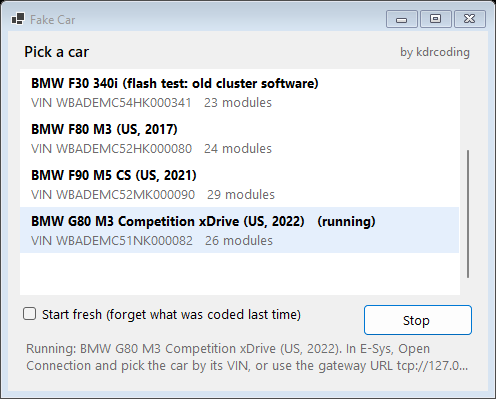
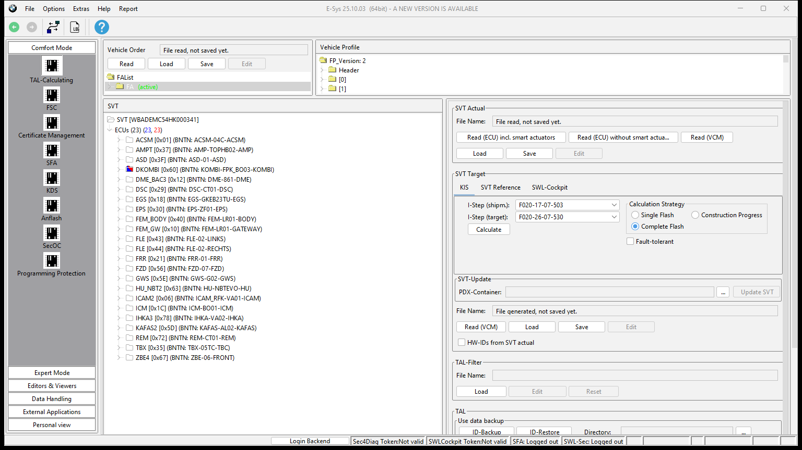

# Fake Car

**A pretend BMW for E-Sys.** Start it on your PC, and E-Sys finds it and works with it like a real car: read and write the vehicle order, code modules, flash software, enter FSC codes, read faults.

Use it to learn E-Sys, try a coding tool before it touches a real car, or record a video without a car and without showing a real VIN.

**[Download the latest version](https://github.com/kdrcoding/fake-car/releases/latest)** · Free · Windows 10 and 11 · by kdrcoding



## Quick start

1. Download `FakeCar-<version>.zip` from [Releases](https://github.com/kdrcoding/fake-car/releases/latest) and unzip it anywhere.
2. Start `FakeCar.exe`, pick a car, press **Start**. The first start of a car builds it from your PSdZData (about half a minute, once).
3. In E-Sys, click **Open Connection** and either
   - pick the Fake Car by its VIN under **Connection via VIN**, or
   - choose **Connection via gateway URL**, enter `tcp://127.0.0.1:6801`, pick the target for that car's series (F010, F020, S15A or S18A), and tick **Read parameters from VCM**.
4. Work as you would with a real car.

Close the window to switch the car off. Everything you change stays for next time. Tick **Start fresh** to go back to the car as it left the factory.

## What you need

- Windows 10 or 11 (nothing else to install)
- E-Sys with PSdZData: F010 for the F10, F020 for the F30 and F80 M3, S15A for the M5 CS, S18A for the G80 M3

## What you can do with it

| In E-Sys | Fake Car |
|---|---|
| Vehicle search, connect by VIN or gateway URL | Yes |
| Read FA, FP, I-steps, VIN | Yes |
| Write FA, FP and I-steps to the VCM | Yes, kept for next time |
| Read SVT, KIS and TAL calculation | Yes |
| Read coding, code modules | Yes, kept for next time |
| Flash software | Yes, the module reports the new version |
| FSC codes (store, read, check, cancel) | Head unit and instrument cluster, F-series cars (G-series use SFA, which needs BMW's backend) |
| Read and clear fault memory | Yes |
| Module reset | Yes |

Tested with E-Sys 25.10: connecting, reading and writing FA, FP and I-steps, SVT, coding, and the flash TAL calculation. A full flash run and the FSC actions inside E-Sys are not tested yet. ISTA finds cars the same way over the network, but it is not tested yet either.

## Car models

| Model | Folder | Modules |
|---|---|---|
| BMW F10 550i xDrive M Sport (US, 2015) | `cars\F10_550i_xDrive_US` | 35 |
| BMW F30 340i M Sport (US, 2017) | `cars\F30_340i_US` | 23 |
| BMW F30 340i with old cluster software, for flash practice | `cars\F30_340i_US_flashtest` | 23 |
| BMW F80 M3 (US, 2017) | `cars\F80_M3_US` | 24 |
| BMW F90 M5 CS (US, 2021) with old cluster software, for flash practice | `cars\F90_M5_CS_US` | 29 |
| BMW G80 M3 Competition xDrive (US, 2022) | `cars\G80_M3_Competition_US` | 26 |

Every VIN is made up.

Each car is built on your own PC from your own PSdZData, the way the factory puts a car together: the modules its order gets, the software E-Sys's own KIS calculation wants on them at the current I-step, and the factory coding of every module for that order. So E-Sys reads what a real car with that order would answer, and a car that is up to date has nothing to flash.

## Flash a module



Use the **F90 M5 CS** or the **F30 340i with old cluster software**: their instrument cluster still has the software it was built with.

1. **Comfort Mode > TAL-Calculating**.
2. Vehicle Order: **Read**. SVT Actual: **Read (ECU) without smart actuators**.
3. SVT Target: tick **Complete Flash**, set **I-Step (shipm.)** to the car's `ISTEP_SHIPMENT` from `car.txt` (S15A-21-03-540 for the M5 CS, F020-17-07-503 for the F30), then **Calculate**.
4. TAL: **TAL calculation**, **Save**, then **Execute**.

## Write FA and FP

1. **Expert Mode > VCM**, tab **Master**, **Read** under FA/FP.
2. Tab **File**: **Save** the FA to a file, then **Load** that file (change the order in between if you like).
3. In the FA tree, right-click the FA and choose **Activate FA**. E-Sys works out the FP.
4. Tab **Master**, **Write** under FA/FP.

## Your own car model

Copy a car folder and change two files:

- `FA.xml`: the vehicle order. `typeKey` (type key), `series` (development series, for example F030 for an F30), `timeCriteria` (MMYY), the SA codes.
- `car.txt`: name, a made-up VIN with a valid check digit, the I-steps (`ISTEP_SHIPMENT` is when it was built), mileage, battery.

`faults.txt` lists the faults it has stored (module address, fault code, status, count, km).

To have something to flash, add `OUTDATED=60` (module addresses, comma separated) to `car.txt`: those modules keep the software they were built with.

Start it in `FakeCar.exe`; it is built on the first start. To build by hand:

```
builder\build-car.cmd cars\F30_340i_US C:\EC-Apps\E-Sys C:\Data
```

## Without the window

```
FakeCar.exe --car cars\F30_340i_US [--bind 127.0.0.1] [--fresh] [--log fakecar.log]
FakeCar.exe --stop
```

Every request and answer is written to `fakecar.log` in the car's folder.

## Good to know

- One tester at a time, like the real central gateway.
- Windows may ask about network access the first time. Other PCs only reach the car if you allow it; E-Sys on the same PC can always use the gateway URL.
- Windows may warn about an app from the internet on the first start: **More info**, then **Run anyway**.
- No BMW data is in this repository. The car data is made on your PC from the PSdZData you already have.

## Build from source

- Fake Car: .NET 10 SDK, `dotnet build src\FakeCar -c Release -o build`
- Builder: JDK 11 or newer, compiled against E-Sys's `lib\PsdZ\psdz-api.jar`:

```
javac --release 11 -cp "C:\EC-Apps\E-Sys\lib\PsdZ\*" -d classes builder\CarBuilder.java
jar cf builder\CarBuilder.jar -C classes .
```

## Licence

MIT, see [LICENSE](LICENSE).

Not made by or connected with BMW AG. BMW, E-Sys and ISTA are names of their owners.
